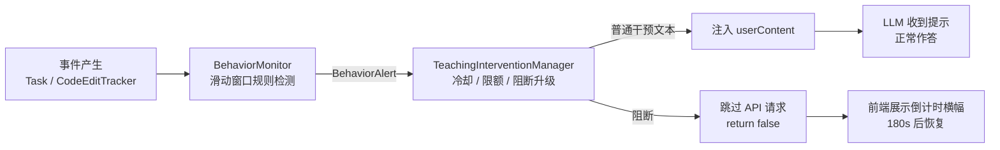
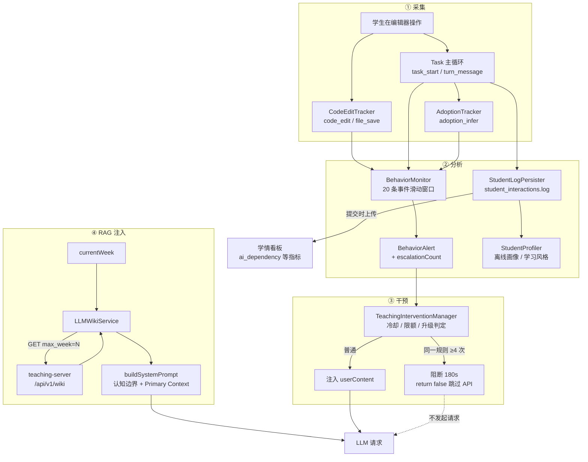

# 教学干预机制与 LLM Wiki（进度感知 RAG）技术分析

> 分析对象：`d:\cline`（Cline 3.53.1 教学 fork，学生端）
> 关联后端：`d:\web-dashboard`（teaching-server，资料/教材/反馈）
> 撰写日期：2026-09-28
>
> 本文聚焦两个教学定制子系统：**行为分析 + 教学干预**（`src/core/task/student-analytics/`）
> 与 **进度感知 RAG**（`src/core/teaching/LLMWikiService.ts`），并说明后者与传统 RAG 的本质差异。

---

## 一、Cline 端代码结构与教学定制模块

### 1.1 分层结构

```
d:\cline  (Cline 教学 fork)
├── src/                              【扩展端 = Node 环境】
│   ├── extension.ts                  插件激活入口
│   ├── core/
│   │   ├── task/
│   │   │   ├── index.ts              ★ Task 主循环：事件采集 / 干预注入 / 阻断执行
│   │   │   └── student-analytics/    ★ 行为采集与分析 + 教学干预
│   │   └── teaching/                 ★ 教学业务（任务、资料库）
│   ├── hosts/vscode/                 VS Code 适配层（Webview provider / IPC）
│   ├── shared/                       扩展端与 webview 共享的类型与消息定义
│   └── integrations/                 终端、编辑器、浏览器等外部集成
├── webview-ui/src/                   【Webview 端 = 浏览器环境，独立 iframe】
│   └── components/
│       ├── teaching/                 教学 UI（任务、LLM 状态、反馈）
│       └── chat/TeachingBlockingBanner.tsx   阻断干预倒计时横幅
└── docs/design/teaching-features.md  教学改动记录（思考链隐藏等）
```

**关键约束**：扩展端（`src/`）与 webview 端（`webview-ui/`）是两个不同的运行时环境，只能通过 `postMessage` / IPC 通信。这决定了两者不能共享 DOM，也解释了两个 webview 视图（侧栏 `WebviewView` 与编辑器区 `WebviewPanel`）彼此无法越界。

### 1.2 教学子系统文件职责

| 文件 | 职责 |
|---|---|
| `student-analytics/types.ts` | 全部类型定义：事件、分类、画像、干预 |
| `student-analytics/CodeEditTracker.ts` | 监听 VS Code 文档事件 → 产出 `code_edit` / `file_save` 事件（**全局单例**，在 `extension.ts` 注册） |
| `student-analytics/TaskClassifier.ts` | 把一次输入归类为 8 种 `TaskCategory` 之一 |
| `student-analytics/ContentAnalyzer.ts` | 内容分析：长度、是否含代码、语言推断 |
| `student-analytics/AdoptionTracker.ts` | 推断 AI 建议是否被采纳（`adopted` / `rejected` / `continued`） |
| `student-analytics/StudentLogPersister.ts` | 事件落盘为 `student_interactions.log`（JSONL） |
| `student-analytics/BehaviorMonitor.ts` | **实时规则检测**（滚动窗口），产出结构化 `BehaviorAlert` |
| `student-analytics/InterventionMessageGenerator.ts` | 按规则 × 严重级 × 风格生成干预文案 |
| `student-analytics/TeachingInterventionManager.ts` | **干预决策与节流**：冷却、限额、阻断升级 |
| `student-analytics/StudentProfiler.ts` | **离线画像**：AI 依赖度、采纳率、学习风格 |
| `teaching/LLMWikiService.ts` | **进度感知 RAG**：按教学周拉取资料、构建 System Prompt |
| `teaching/AssignmentManager.ts` | 实验任务下发、代码提交、学生信息持久化 |

---

## 二、行为采集：什么行为会被记录

### 2.1 事件数据结构

每条事件是一个 `StudentInteractionLog`（`types.ts`）：

| 字段 | 含义 |
|---|---|
| `ts` | ISO 8601 时间戳 |
| `taskId` | 任务（对话）唯一标识 |
| `eventType` | 事件类型，见下表 |
| `role` | `user` / `assistant` / `system` |
| `category` | 任务分类（8 类） |
| `contentLength` / `hasCode` / `languageHint` | 内容分析结果 |
| `imageCount` / `fileCount` | 附带图片/文件数 |
| `turnIndex` | 当前任务内的第几次交互（自增） |
| `rawContent` | 原始内容（**仅当长度 ≤ 2000 字符时才记录**） |
| `suggestionType` | AI 建议类型（仅 assistant） |
| `toolsUsed` | AI 调用的工具名列表（仅 assistant） |
| `filePath` / `changeDelta` | 文件路径与变更量（仅编辑类事件） |
| `adoptionStatus` | 采纳推断结果（由后续事件回填） |

### 2.2 五类事件及其采集点

| `eventType` | 触发时机 | 采集位置 |
|---|---|---|
| `task_start` | 新任务首次提交 | `Task.persistTaskStartLog()` |
| `turn_message` (role=user) | 同一任务内用户发后续消息 | `Task.persistTurnLevelLog()` |
| `turn_message` (role=assistant) | AI 回复流结束 | `Task.persistAssistantTurnLog()` |
| `code_edit` | 学生**在编辑器中实际修改文本** | `CodeEditTracker`（监听 `onDidChangeTextDocument`） |
| `file_save` | 学生**保存文件** | `CodeEditTracker`（监听 `onDidSaveTextDocument`） |
| `adoption_infer` | AI 回复后推断学生是否采纳 | `Task.persistAdoptionInferLog()` → `AdoptionTracker` |

> 注意：**只有真实发生在编辑器里的编辑/保存才算 `code_edit`/`file_save`**。AI 通过 `replace_in_file` 等工具改写的文件不计入学生的自主编辑 —— 这是后续"自主修改率"指标成立的前提。

### 2.3 行为类型（分类维度）

**`TaskCategory`（8 类，由 `TaskClassifier` 判定）**：
`algorithm` · `debugging` · `explanation` · `language_request` · `code_generation` · `refactoring` · `testing` · `other`

**`SuggestionType`（AI 建议类型，8 类）**：
`code_generation` · `code_edit` · `explanation` · `question` · `completion` · `command` · `mixed` · `other`

**`AdoptionStatus`（采纳状态，4 类）**：
`adopted`（AI 回复后出现了相关编辑/保存）· `rejected` · `continued`（在该建议基础上继续追问）· `unknown`（样本不足，不参与统计）

**`LanguageHint`**：`cpp` / `python` / `java` / `javascript` / `typescript` / `c` / `unknown`

---

## 三、教学干预机制

### 3.1 三层架构



**设计原则**（`TeachingInterventionManager` 文件头注释明确列出）：

1. 不阻断 AI 原有生成流程（阻断模式除外）
2. 不修改用户原始输入
3. 不替换 AI 正常回答
4. 只在对话流中**插入**引导式提示
5. 与现有模块解耦，可独立启停（受设置项 `behaviorMonitorEnabled` 控制）

### 3.2 触发规则：4 条，全部基于滚动窗口

`BehaviorMonitor` 维护一个长度为 **20 条事件**的滑动窗口（约 4 轮完整对话，每轮约 5 条事件）。每次 `ingest(event)` 后立即评估全部 4 条规则：

| 规则 ID | 触发条件 | 默认阈值 | 窗口内度量 |
|---|---|---|---|
| `consecutive_code_generation` | 连续 N 次拿到含代码的 AI 回复 | `consecutiveAssistantCodeThreshold = 3` | `assistantCodeStreak`（连续计数） |
| `no_edit_streak` | 连续 N 轮没有任何代码编辑 | `noEditTurnStreakThreshold = 5` | `turnsSinceLastEdit`（连续计数） |
| `high_adoption_low_self_modification` | 采纳率高 **且** 自主修改率低 | `adoptionRateThreshold = 0.7`<br/>`selfModificationThreshold = 0.25`<br/>最少样本 `minAdoptionSamples = 2` | `adoptionRate`、`selfModificationRate` |
| `high_recent_ai_dependency` | 窗口内 AI 发言占比过高 | `aiDependencyThreshold = 0.7`<br/>最少轮次 `minTurnsForDependency = 4` | `assistantTurns / totalTurns` |

**两处关键的计数细节**（代码注释显式说明，属于踩坑后的修正）：

- `assistantCodeStreak` **只在 `code_edit` 事件时清零**。AI 发送不含代码的消息（`execute_command`、`read_file`、纯提示文本）**不会**打断连续计数 —— 否则"让 AI 一遍遍写代码"这种真实依赖模式会被中间的读文件操作掩盖。
- `no_edit_streak` 与 `assistantCodeStreak` 都在 `code_edit` 时同时归零。

### 3.3 什么行为会触发干预（完整清单）

1. **连续索取代码**：窗口内连续 3 次 AI 回复都带代码，且期间学生自己没有编辑过文件
2. **只看不改**：连续 5 轮没有任何编辑器改动
3. **只采纳不消化**：≥2 条可判定的采纳样本中，采纳率 ≥ 70%，同时"学生编辑次数 / AI 含代码回复数" ≤ 25%
4. **单方面对话**：窗口内 ≥4 轮消息中，AI 发言条数占比 > 70%

### 3.4 升级为阻断式干预

每次规则命中都会递增该规则的 `escalationCounter`。当**同一规则累计触发 ≥ 4 次**（`escalationBlockingThreshold`），在下一轮对话前升级为**阻断式干预**：

| 阻断特征 | 值 |
|---|---|
| 冷却时长 `blockingCooldownMs` | **180_000 ms（3 分钟）** |
| 禁用功能 | 代码生成 + 工具执行 |
| 同一任务内触发次数 | **仅 1 次**（`blockingTriggered` 标志） |
| 展示内容 | 反思引导问题 + 实时倒计时 |
| 跨会话 | **全局静态生效** —— 退出对话/新建对话**不能**绕过 |

**阻断的强制点**在 `Task` 主循环（`src/core/task/index.ts`）：

```ts
if (interventionManager.isBlockingActive()) {
    await this.say("text", interventionText || `⏳ 【阻断冷却中 — 剩余 ${timeDisplay}】...`)
    // 🔒 关键：阻止 API 请求，该轮对话直接结束
    return false
}
```

注意这里**先于**普通干预判断，且**不依赖** `interventionText` 是否为空 —— 保证学生连续发消息时每一次都被拦截。

### 3.5 节流：三级冷却 + 双重限额

| 机制 | 默认值 | 作用范围 |
|---|---|---|
| 规则级冷却 `cooldownMs` | 15 s | `BehaviorMonitor` 内，**同一条规则**不重复报警 |
| 全局冷却 `globalCooldownMs` | 5 s | `TeachingInterventionManager` 内，**任意**普通干预之间的最小间隔（阻断模式跳过此检查） |
| 轮次间隔 `minTurnsBetweenInterventions` | 0（不限制） | 两次干预之间的最少对话轮数 |
| 单任务限额 `maxInterventionsPerTask` | 10 | 含阻断在内，单任务干预上限 |
| 阻断冷却 | 180 s | 阻断期间完全不触发新干预 |

**所有节流判定失败都会走 `Logger.info` 记录跳过原因**（如 `skipped: global cooldown active (3000ms remaining)`），便于排查"为什么没有干预"。

### 3.6 干预风格与消息生成

`InterventionStyle` 有 5 种：`hint`（提示型，默认）· `question`（提问型）· `challenge`（挑战型）· `reflection`（反思型）· `blocking`（阻断型）。

`InterventionMessageGenerator` 用 `TEMPLATE_REGISTRY[ruleId][severity]` 的二维表选择模板，其中 `InterventionSeverity` 分 `gentle` / `moderate` / `strong` 三级。生成的消息经 `formatInterventionForInjection()` 包装后注入。

**注入方式按类型分叉**：

| 类型 | 注入位置 | 效果 |
|---|---|---|
| 普通干预 | `userContent.push({ type: "text", text: interventionText })` | 作为**用户消息的一部分**送给 LLM，AI 能看到提示后正常作答 |
| 阻断干预 | 不构建 API 请求，`return false` | AI 完全不出手；学生只能自己写代码 |

> 普通干预选择注入 `userContent` 而非 `systemPrompt`，是因为它必须**当轮生效**且不污染系统提示的长期语义 —— 但这也意味着它会进入对话历史，被后续上下文压缩一并处理。

### 3.7 前端配套：倒计时横幅

`TeachingBlockingBanner.tsx` 挂在 `<Navbar />` 正下方，显示 `⏳ 教学干预中：代码生成与工具执行已暂停 剩余 02:59`。

数据流（v2.7 起跨会话）：

```
TeachingInterventionManager（实例 + 全局静态 globalBlockingEndsAt）
  → Task.getBlockingState() / TeachingInterventionManager.getGlobalBlockingState()
  → Controller.getStateToPostToWebview()   // 全局优先，其次当前 Task
  → sendStateUpdate → ExtensionStateContext → TeachingBlockingBanner
```

横幅内部用本地 `setInterval(1000)` 自行递减，**不需要扩展端每秒推送**。

---

## 四、AI 依赖度与相关指标的计算

### 4.1 实时版（`BehaviorMonitor.checkHighRecentAiDependencyRule`）

```
aiDependency = 窗口中 role=assistant 的 turn_message 数
             / 窗口中全部 turn_message 数        (role=user + role=assistant)
```

- 统计范围：**最近 20 条事件窗口内**
- 前置条件：`turns.length >= 4`
- 触发条件：`aiDependency > 0.7`
- 用途：**实时干预**

代码注释特别说明阈值取 0.7 而非更低的原因：*"Cline 多工具调用场景下可达"* —— 因为一次用户提问会引发 AI 的多次工具调用与多段回复，AI 发言天然占多数，阈值过低会大面积误报。

### 4.2 画像版（`StudentProfiler.calcAiDependency`）

```
aiDependencyScore = assistantTurns / (userTurns + assistantTurns)
```

- 统计范围：**该学习者全部日志**（不限窗口）
- 样本来源：`eventType ∈ {task_start, turn_message}` 的日志
- 输出：写入 `StudentProfile.aiDependencyScore`，范围 [0, 1]
- 用途：学习风格推断、离线画像报告

同文件其余指标：

| 指标 | 公式 |
|---|---|
| `codeEditRatio` | `code_edit 次数 / AI 含代码回复数`，clamp 到 [0,1] |
| `adoptionRate` | `adopted / (adopted + rejected + continued)`，**排除 `unknown`** |
| `selfModificationRate` | `有 code_edit 的任务数 / 有 AI 代码输出的任务数` |
| `debuggingFrequency` | `debugging 类任务 / 总任务` |
| `explorationBreadth` | `使用过的 category 数 / 全部 category 数` |

### 4.3 服务端版（`teaching-server`，用于学情看板）

后端从同一份 `student_interactions.log` 重新计算（`computeMetricsFromLogs()`）：

```ts
const totalTurns     = events.length                        // ⚠️ 全部事件条数
const assistantTurns = events.filter(e =>
    e.role === "assistant" || e.category === "code_generation").length
const aiDependency   = assistantTurns / totalTurns          // 保留两位小数，clamp 0~1
```

同源指标一并计算：

```ts
user_edit_count     = code_edit 事件数 + category=refactoring 事件数
metric_gaming_score = adoptionRate * 0.7 + (assistantTurns / totalTurns) * 0.3
```

结果写入 SQLite 的 `submissions.ai_dependency` / `metric_gaming_score` / `user_edit_count`，供看板展示。

> ⚠️ 注意这里的 `totalTurns` **名不副实**：它等于 `events.length`，即日志里的**全部事件条数** ——
> 包含 `code_edit`、`file_save`、`adoption_infer` 这些**非对话事件**。详见 §4.5。

### 4.4 学习风格推断

`StudentProfiler.inferLearningStyle()` 基于上述 6 个指标推断 `LearningStyle`，并给出 `styleConfidence`（置信度）：

| 风格 | 特征描述 |
|---|---|
| `Exploratory` | 探索型 —— 多轮对话、尝试多类别、主动修改代码 |
| `Dependent` | 依赖型 —— 高度依赖 AI 输出、较少自主编辑 |
| `Optimizer` | 优化型 —— 采纳 AI 建议后频繁自主修改打磨 |
| `Debugger` | 调试型 —— 以调试类任务为主 |
| `Balanced` | 均衡型 —— 各维度适中 |

判定使用 `sigmoid(x, 0.65, 10)` 做软阈值映射、`midness(x)` 做"中间态"度量。以 `Dependent` 为例：

```
Dependent = sigmoid(aiDependencyScore, 0.65, 10) * 0.4
          + (1 - selfModificationRate) * 0.3
          + (1 - codeEditRatio) * 0.3
```

即"高 AI 依赖 + 低自主修改 + 低编辑比"三者加权 —— 权重 0.4/0.3/0.3 体现了"AI 依赖是主导因素，但必须与自主行为交叉验证"。

### 4.5 ⚠️ 三处口径不一致（值得注意的现状）

| 版本 | 统计范围 | 分子（assistant 侧） | 分母 |
|---|---|---|---|
| `BehaviorMonitor` | 最近 **20 条事件**窗口 | `role=assistant` 的 `turn_message` | 窗口内 `turn_message` 总数 |
| `StudentProfiler` | **全量日志** | `assistantTurns` | `user + assistant` turns |
| `teaching-server` | **单次提交的全量日志** | `role=assistant` **或** `category=code_generation` 的事件 | **`events.length`（全部事件条数）** |

第二个版本与另两个的差异是**性质上的**，不只是时间跨度不同：

`code_edit`、`file_save`、`adoption_infer` 这些**非对话事件也被计入服务端的分母**，
而分子只数 assistant 侧事件 —— 于是**服务端算出的 AI 依赖度会被系统性稀释、偏低**。

举例：一段日志含 4 条 user turn、6 条 assistant turn，另有 10 条 `code_edit`/`file_save`：

| 口径 | 计算 | 结果 |
|---|---|---|
| 客户端画像 | `6 / (4 + 6)` | **0.60** |
| 服务端 | `6 / (4 + 6 + 10)` | **0.30** |

同一个学生、同一份日志，两个数字相差一倍。且编辑行为越活跃（本该是**好事**），服务端分数被稀释得越厉害 ——
**方向是反的**。

因此前述"干预看当下趋势、画像看长期特征"只是解释了前两者之间的差异；
服务端与客户端之间的差异属于**实现口径缺陷**，不能靠教学设计来解释。

---

## 五、LLM Wiki：与传统 RAG 的区别

### 5.1 传统 RAG 的形态

```
离线：文档 → 切块 → Embedding → 向量库
在线：Query → Embedding → 向量相似度 Top-K 检索 → 拼入 Prompt → LLM
```

核心机制是**语义相似度检索**：检索键是「问题与文档块在向量空间中的距离」。

### 5.2 本项目的形态

```
后端（教师端）：
  上传教材/资料 → OCR/解析 → LLM 清洗成结构化 Markdown
  → LLM 决定 chunk 切分（≤5 块）→ 教师标注 applicable_week → 存入 SQLite

客户端（学生端 LLMWikiService）：
  当前教学周数 currentWeek
  → GET /api/v1/wiki?max_week=N
  → 过滤 applicable_week <= N
  → 按周数 + id 排序，逐块截断（单块 4000 字）
  → 拼装 System Prompt（总上限 16000 字）
  → 注入 Task 的 systemPrompt
```

**检索键是「教学周数」，不是语义相似度。没有 embedding，没有向量库，没有相似度计算。**

### 5.3 生成出来的 System Prompt

`LLMWikiService.buildSystemPrompt()` 的结构（这是整个设计最核心的产物）：

```
# 角色
你是一名严格的 Python 编程教师，正在为第 {week} 周的学生答疑。

# 认知边界约束（不可违反）
1. 你只能引用第 1 ~ 第 {week} 周已被教师发布的资料作为答疑依据。
2. 严禁使用超出当前周数的高级语法、设计模式或高级库函数
   （如装饰器、async/await、推导式嵌套等需在更高周数才引入）。
3. 若学生提问涉及超纲内容，必须明确告知"该知识点将在第 Y 周讲解"，
   并提供入门指引。

# 优先参考知识（Primary Context）
{按周数过滤并排序后的 wiki chunk 拼接}

# 教材章节（v2.0）
{教材章节拼接，单章截断 2000 字}

# 学生提问
{userQuery}
```

注入点：`src/core/task/index.ts`，在拿到基础 systemPrompt 之后：

```ts
const ragContext = llmWiki.buildSystemPrompt(userQuery)
systemPromptFinal = systemPrompt + "\n\n" + ragContext
```

紧随其后还会追加【教学约束】（禁止输出思考链），以及缓存为空时**同步拉取**的兜底（≤3s 超时，失败则用空 RAG 继续）。

### 5.4 与传统 RAG 的本质差异

| 维度 | 传统 RAG | 本项目 LLM Wiki |
|---|---|---|
| **检索键** | 语义相似度（向量距离） | **教学周数**（`applicable_week <= currentWeek`） |
| **索引结构** | 向量库（FAISS / pgvector / …） | 无。SQLite 表 + 内存 `Map<baseId, chunks>` |
| **切块方式** | 固定长度或语义分割算法 | **由 LLM 清洗时决定**，chunk 数 ≤ 5 |
| **相关性排序** | 按相似度打分 Top-K | 无打分。按 `applicable_week` + `id` 排序 |
| **上下文边界** | token 预算 | token 预算 **+ 教学进度边界**（认知边界） |
| **提示词重心** | "请依据以下资料回答" | "**你不许讲第 N 周之后的内容**" |
| **失败模式** | 检索不到 → 答不上 | 检索为空 → 允许用通用知识作答（降级） |
| **可解释性** | 需展示相似度分数 | 边界清晰：第几周的资料，一目了然 |
| **更新方式** | 重新 embedding 全文 | 教师改一行 Markdown 即生效 |

### 5.5 一句话概括差异

> **传统 RAG 回答的是「哪段资料与这个问题最相关」；
> 本项目回答的是「这个学生在当前教学进度下，被允许看到哪些资料」。**
>
> 前者是**相关性**问题，后者是**教学边界**问题。

这带来两个传统 RAG 不具备的性质：

1. **可控的认知边界**：即使学生问"怎么用装饰器"，模型也会被约束为"第 12 周才讲"，而不是在资料库里检索出一段装饰器文档然后照答。这是**教学法层面的约束**，不是检索技术能提供的。
2. **进度即权限**：资料不是"能不能被搜到"的问题，而是"教师有没有在第 N 周发布"的问题。这让 RAG 从**信息检索**变成了**课程编排**。

### 5.6 为何能不用向量检索

三个前提使向量检索变得不必要：

1. **语料规模小**：一学期的课程资料，一个教学周通常只有几份文档，过滤后总量可控
2. **过滤维度天然强**：`applicable_week` 是最强的先验 —— 它一次性把候选集缩小到"当前进度之前"
3. **注入是有上限的**：`TOTAL_CONTEXT_CHARS = 16_000`，超限直接截断并插入 `> （后续 chunk 已省略，避免 token 超限）` 提示

也就是说：**用教学进度做过滤，比用语义相似度做排序更契合场景**。学生需要的不是"最相关的资料"，而是"**当前能学的资料**"。

### 5.7 可选的工具调用模式（karpathy 式按需检索）

当 `clineTeaching.llmEnableTools` 打开时，`answerWithTools()` 会走另一条路径：

- 注册 3 个工具：`grep_wiki`（按关键词搜索 chunk）、`read_chunk`（读取完整 chunk）、`list_weeks`（列出已加载周数）
- 最多 **5 轮**（`MAX_TOOL_ROUNDS`）工具调用，多工具**并行**执行
- 超过 5 轮强制收敛，退化为单轮 `buildSystemPrompt`

这是对"全量注入"的补强：**简单问题直接答，复杂/跨周/对比问题才按需检索**。默认关闭，因为工具调用会增加时延与 token 消耗。

---

## 六、端到端数据流总览



---

## 七、设计权衡与已知问题

### 7.1 做得好的地方

1. **不打断教学流程**：干预默认以"注入提示"方式存在，AI 仍能正常答疑 —— 只在依赖模式反复出现（同规则累计 4 次）才升级为强制阻断。
2. **阻断无法绕过**：`globalBlockingEndsAt` 为静态字段，退出对话/新建对话均无效，堵住了最明显的规避路径。
3. **口径分离合理**：实时干预看**窗口趋势**，离线画像看**长期特征**，两者本就是不同问题。
4. **每个节流跳过都有日志**：`Logger.info` 记录了完整的跳过原因与剩余时间，排查"为何未触发干预"时不需要读代码。
5. **RAG 失败可降级**：wiki 拉取超时/失败时 `systemPrompt` 保持原样，答疑功能不受影响。

### 7.2 值得关注的局限

| # | 问题 | 影响 | 建议方向 |
|---|---|---|---|
| 1 | **服务端 AI 依赖度分母混入非对话事件**（§4.5）：`totalTurns = events.length` 把 `code_edit`/`file_save`/`adoption_infer` 一并计入分母；量名也叫 `totalTurns`，易被误读为"轮次数" | 看板分数**系统性低于**客户端画像（实测样例：0.30 vs 0.60），且**编辑越活跃分数越低** —— 方向与教学意图相反 | 服务端改为只统计 `turn_message`（`role ∈ {user, assistant}`）作为分母，与 `StudentProfiler` 对齐；变量名改为 `totalEvents` 以免误读 |
| 2 | **全量注入无相关性排序** | 资料多时靠 `id` 排序截断，可能优先丢弃更相关的块 | 截断前可按 `chunk_index` 归并，避免"同一资料被截断一半" |
| 3 | **`rawContent` 仅记录 ≤2000 字符** | 长输入的原始内容缺失，离线分析只能拿到长度/分类 | 已是隐私与可用性的折中，可接受 |
| 4 | **阻断上限为"每任务 1 次"** | 学生开启新对话后虽然冷却仍在（180s），但冷却结束后该任务不再阻断 | `escalationCounter` 已随任务重置，属设计选择 |
| 5 | **`applicable_week` 是唯一过滤维度** | 教师若把大量资料都标在第 1 周，会一次性占满 16k 上下文 | 教师端可在发布前做"每周资料量"提示 |
| 6 | **工具调用模式默认关闭** | 跨周对比类问题的效果依赖全量注入是否完整 | 可在"资料量超过阈值时自动启用" |

---

## 附：关键常量速查

| 常量 | 值 | 位置 |
|---|---|---|
| 行为窗口大小 | 20 条事件 | `BehaviorMonitor.DEFAULT_OPTIONS.windowSize` |
| 规则级冷却 | 15 s | `cooldownMs` |
| 全局干预冷却 | 5 s | `InterventionManagerOptions.globalCooldownMs` |
| 单任务干预上限 | 10 次 | `maxInterventionsPerTask` |
| 阻断升级阈值 | 同规则 4 次 | `escalationBlockingThreshold` |
| 阻断时长 | 180 s | `blockingCooldownMs` |
| AI 依赖阈值（实时） | 0.7 | `aiDependencyThreshold` |
| 连续代码生成阈值 | 3 次 | `consecutiveAssistantCodeThreshold` |
| 连续无编辑阈值 | 5 轮 | `noEditTurnStreakThreshold` |
| 单 chunk 截断 | 4 000 字 | `CHUNK_TRUNCATE_CHARS` |
| 教材单章截断 | 2 000 字 | `_buildTextbookContext` |
| System Prompt 总上限 | 16 000 字 | `TOTAL_CONTEXT_CHARS` |
| 工具调用最大轮数 | 5 | `MAX_TOOL_ROUNDS` |
| 事件落盘文件 | `student_interactions.log` | `StudentLogPersister` |
