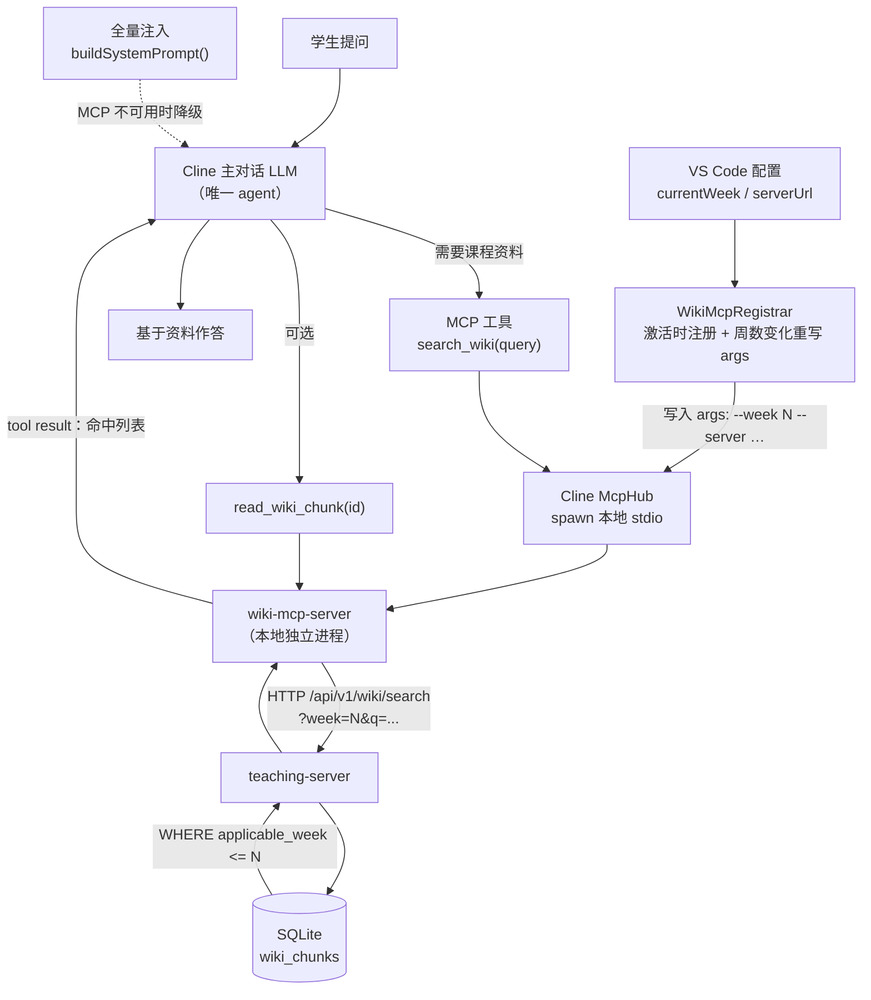

# Wiki 检索 MCP 化改造设计文档

> 目标：把「教师资料库」从**预注入**模式改为**LLM 自主检索**模式（karpathy 式 agentic retrieval），
> 消除全量注入被截断的问题，同时**在教学进度边界上做到不可绕过**。
>
> 撰写日期：2026-09-28
> 涉及仓库：`d:\cline`（学生端插件）、`d:\web-dashboard`（teaching-server）
> 相关文档：`docs/design/wiki-rag-design.md`（初版 RAG 设计）、`docs/design/teaching-intervention-and-llm-wiki.md`（现状分析）

---

## 0. 背景与问题

### 0.1 现状

学生端答疑链路上，资料进入模型上下文的**唯一路径**是（`src/core/task/index.ts`）：

```ts
const ragContext = llmWiki.buildSystemPrompt(userQuery)
systemPromptFinal = systemPrompt + "\n\n" + ragContext
```

`buildSystemPrompt()` 的行为（`src/core/teaching/LLMWikiService.ts`）：

1. 取内存缓存中 `applicable_week <= currentWeek` 的全部 chunk
2. 按 `applicable_week` + `id` 排序
3. 从头拼接，每块截断 4000 字，总量封顶 16000 字，超限即**中止并插入省略提示**

### 0.2 三个问题

| # | 问题 | 说明 |
|---|---|---|
| P1 | **容量截断** | 超过 16000 字的部分**直接丢弃**。截断依据是 `week + id` 的字典序，**与问题相关性无关** —— 可能丢掉恰好需要的那一块 |
| P2 | **检索面不完整** | `grep_wiki` / `read_chunk` 跑在 `_wikiCache`（**已拉取到内存的子集**）上，而不是完整资料库。没拉取过的资料搜不到 |
| P3 | **karpathy 式能力未接线** | `answerWithTools()` 与三个工具（`grep_wiki` / `read_chunk` / `list_weeks`）**代码存在但无任何调用点**；`llmCaller` 从未被构造。设置页的 `clineTeaching.llmEnableTools` 开关是**空开关** |

此外，现有工具实现存在**边界可绕过**缺陷：

```ts
// LLMWikiService._executeToolCall
const maxWeek = Number(args["max_week"] ?? this._currentWeek)  // ← LLM 可传 18
```

`grep_wiki` 接受 LLM 指定的 `max_week` 且**无上限校验**，学生（或提示注入）让模型传 `max_week: 18` 即可读取未来周资料。教学边界形同虚设。

---

## 1. 目标与非目标

### 1.1 目标

- **G1** 答疑时资料按需取用，不再出现"因容量上限被盲截断"
- **G2** 检索基于**完整资料库**（服务端全表），而非客户端内存子集
- **G3** 教学进度边界**不可被 LLM 绕过**（由系统强制，不由模型协商）
- **G4** 不引入新的密钥暴露面（LLM key 仍归教师端）
- **G5** 尽少触碰 Cline 上游代码
- **G6** 资料更新**即时生效** —— 教师改完内容，学生下一次检索即可取到，不受客户端缓存与容量上限影响（见 §D7）
- **G7** 超纲提问**不拒答、也不超纲作答** —— 学生问尚未发布的知识点时，应告知其所属周次并给出当前进度内的相关基础（见 §D6 子节）

### 1.2 非目标（明确不做）

| 不做 | 原因 |
|---|---|
| 让 LLM 维护/改写 wiki 内容 | 教学资料需教师权威，不容模型自主改写。本次只改**检索方式**，不改**知识生产方式** |
| 引入向量检索 / embedding | 教学进度是比语义相似度更强的先验；且会引入向量库依赖 |
| 改造 `wiki_chunks` 数据结构 | 现有 `source_textbook_id` / `applicable_week` / `chunk_index` 已满足需求 |
| 移除全量注入 | 保留为**降级路径**（见 §4.5） |

---

## 2. 方案选型

### 2.1 候选对比

| | 方案 1 服务端 sub-agent | 方案 2a 客户端 loop | 方案 2b 原生工具 | **方案 3 MCP（选定）** |
|---|---|---|---|---|
| Agent 数量 | 2（多一个检索 agent） | 2 | 1 | **1** |
| 额外 LLM 调用 | +N 轮（N≤5） | +N 轮 | 0 | **0** |
| 检索时机 | 预付（对话前批量取） | 预付 | 真按需 | **真按需** |
| 改 Cline core | 1 文件 1 处 | 1 文件 1 处 | **5+ 文件**（枚举/prompt/注册/解析/执行） | **0 ～ 1 文件 1 处**（见 §4.6） |
| 边界强制 | 服务端 SQL | 客户端（可伪造） | 服务端 SQL | **服务端 SQL + 本地 server 注入** |
| 上游冲突风险 | 低 | 低 | **高**（含 prompt 快照测试） | **最低** |

### 2.2 为什么选 MCP

Cline **原生支持 MCP**，`use_mcp_tool` / `access_mcp_resource` 已是注册好的工具。把 wiki 检索做成 MCP server 后：

- 主对话的 LLM 在需要时**自己调用**检索工具 —— 与方案 2b 体验一致，但**不需要动工具链代码**
- 检索是主对话的一部分，**零额外 LLM 调用**（这正是方案 1/2a 的主要成本）
- 检索者与被检索者**共享同一上下文**（模型知道自己正在写什么、刚问过什么）

**决定性发现**：Cline 已内置「**管理员统一下发 MCP 配置**」机制 ——
`src/core/storage/remote-config/syncRemoteMcpServers.ts` 文件头注释原文：

> This allows **admins to centrally configure MCP servers** that are automatically deployed to users

这与教学场景（教师统一部署）天然契合。

---

## 3. 架构

### 3.1 组件

| 组件 | 位置 | 职责 |
|---|---|---|
| **Cline 主对话** | `d:\cline` 现有 | 唯一 agent。决定何时检索、如何作答 |
| **wiki-mcp-server**（新增） | `d:\cline\dist\mcp-wiki-server.js` | 本地 stdio MCP server。**唯一职责：把 VS Code 配置的 `currentWeek` 注入检索请求并转发给后端** |
| **配置引导器**（新增） | `d:\cline\src\core\teaching\WikiMcpRegistrar.ts` | 插件激活时确保 `cline_mcp_settings.json` 中存在 wiki server 条目（读-改-写，不覆盖他人配置） |
| **检索 API**（新增） | `d:\web-dashboard\teaching-server/src/server.ts` | `/api/v1/wiki/search`、`/api/v1/wiki/chunk`、`/api/v1/wiki/weeks`，**SQL 层强制周数边界** |

### 3.2 数据流



### 3.3 边界防线（三层，均不可被 LLM 影响）

| 层 | 机制 | 说明 |
|---|---|---|
| **L1 工具 schema** | 工具参数**不暴露任何周数字段** | LLM 无渠道指定范围 |
| **L2 本地 server 注入** | `currentWeek` 由本地进程从 VS Code 配置读取 | 位于模型进程之外，模型无法写入 |
| **L3 服务端 SQL** | `WHERE applicable_week <= ?`，且 `read_wiki_chunk` 校验目标 chunk 的周数 | 最后一道，也是唯一可信的一道 |

> 设计原则：**边界判定不放客户端、不进提示词、不受模型影响**。
> 即便学生用提示注入诱导模型"读取第 18 周资料"，模型也只能调用 `search_wiki(query)` —— 它根本没有传周数的参数。

---

## 4. 关键设计决策

### D1：MCP server 采用**本地 stdio**，而非远程 streamableHttp

| | 本地 stdio | 远程 streamableHttp |
|---|---|---|
| 如何获知"当前周" | **直读 VS Code 配置**（权威） | 服务端不知道（周数是客户端本地配置） |
| 边界可信度 | 高 | 需额外状态同步，或把周数放进 URL/headers 并动态改写配置 |
| 部署 | 随插件打包，零额外服务 | 需公开 MCP 端点 + 鉴权 |
| 网络暴露 | 无 | 需暴露 MCP 端点 |

→ **选本地 stdio**。服务端只需要一个普通 REST 检索接口，不必承载 MCP 协议。

**启动方式**（需在目标环境验证，见 §10）：

```json
{
  "mcpServers": {
    "wiki": {
      "type": "stdio",
      "command": "<process.execPath>",
      "args": [
        "<extensionPath>/dist/mcp-wiki-server.js",
        "--week", "5",
        "--server", "http://<教学后端地址>:4001"
      ],
      "env": { "ELECTRON_RUN_AS_NODE": "1" },
      "autoApprove": ["search_wiki", "read_wiki_chunk", "list_wiki_weeks"],
      "timeout": 30
    }
  }
}
```

**为什么周数必须作为启动参数传**：stdio MCP server 是**独立进程**，进程内没有 `vscode` 模块，
读不到 `clineTeaching.currentWeek`。所以 `currentWeek` 与 `serverUrl` 只能由插件在 spawn 时通过 `args` / `env` 注入。

代价：**周数变化需要重写 `args` 并让 MCP server 重载** —— 由 `WikiMcpRegistrar` 监听配置变化完成（见 §D2）。

> 这也意味着：**“当前周”这个权威值始终在模型进程之外传递** —— 从 VS Code 配置 → 插件 → 进程启动参数 → HTTP 请求，
> 模型在任何一环都无写入渠道。

### D2：配置分发采用**插件激活时自注册**

Cline 已有两种机制，但都不完全适用：

| 机制 | 位置 | 局限 |
|---|---|---|
| 远程统一下发 | `syncRemoteMcpServers.ts` | 该函数**硬编码** `autoApprove: []` 与 `type: "streamableHttp"`，**不支持 stdio**，且会覆盖 autoApprove → 每次检索都会弹审批，体验不可接受 |
| 手动配置 | `cline_mcp_settings.json` | 需逐台操作 |

→ 采用**第三种**：在插件激活时由教学定制代码写入。

```ts
// src/core/teaching/WikiMcpRegistrar.ts（新增）
export async function ensureWikiMcpServer(context: vscode.ExtensionContext): Promise<void> {
  // 1. getMcpSettingsFilePath(settingsDirectoryPath)  ← 现成导出函数
  // 2. 读取现有 JSON；不存在则以 { mcpServers: {} } 初始化
  // 3. 若 mcpServers.wiki 已存在且 command/args 未变 → 直接返回（幂等）
  // 4. 否则写入完整条目（含 autoApprove 白名单）
  // 5. 写回文件；McpHub 的文件 watcher 会自动重载，无需手动触发
}
```

调用点：`src/extension.ts` 的 `activate()`（该文件已是项目既有的教学定制点，此处已初始化 `LLMWikiService`）。

**幂等性要求**：仅在条目缺失、或 `args` 中的 `--week` / `--server` 与当前配置不一致时写入；绝不清空用户已有的其他 server。

**三条操作边界**（对应 §D5 的“禁用可控、删除无效”策略）：

| 学生操作 | 系统行为 |
|---|---|
| **禁用**（`disabled: true`） | **尊重**，不覆盖。仅在配置变化时提示后果并提供“重新启用”（§D5） |
| **删除**条目 | **不允许** —— 每次插件激活时检测，缺失即**从插件自带配置重建**（删除视为无效操作） |
| **篡改** `command` / `args` | 覆盖回正确值（否则功能不可用） |

**周数变化处理**：`WikiMcpRegistrar` 同时注册 `onDidChangeConfiguration` 监听。
当 `clineTeaching.currentWeek` 或 `serverUrl` 变化时，重写条目中的 `args` 并触发 MCP 重载（毫秒级，不影响对话）。
因此自注册不是“一次性”动作，而是**随周数变化幂等重写**。

### D3：自动批准通过条目内 `autoApprove` 预置

Cline 的 MCP 配置支持**工具级白名单**（`schemas.ts` 的 `AutoApproveSchema`）：

```ts
export const AutoApproveSchema = z.array(z.string()).default([])
```

预置 `["search_wiki", "read_wiki_chunk", "list_wiki_weeks"]`，三个只读工具免审批。
写入型工具**不存在**，因此无需担心自动批准带来的写入风险。

### D4：检索算法 —— 关键词 + 结构化排序，不做向量

服务端检索策略（`teaching-server`）：

1. **候选集**：`WHERE applicable_week <= ?`（硬约束）
2. **匹配**：标题命中 > 正文命中；正文匹配用 `LIKE '%q%'`（后续可平滑升级为 FTS5）
3. **排序**：`标题命中 DESC, applicable_week DESC, chunk_index ASC`
   —— 同等相关度下**优先取更近周**的内容（教学上更贴合当前上下文）
4. **限量**：`limit` 默认 5，上限 10

> 为什么不向量化：本场景的强先验是**教学进度**而非语义相似度；且语料规模在一学期课程量级，关键词检索足以覆盖。保持"零向量依赖"与项目既有定位一致。

### D5：**不做**全量注入兜底；改为「禁用可控 + 删除无效 + 失败可见」

MCP 链路的失效场景及处置：

| 失效场景 | 处置 |
|---|---|
| 学生**手动禁用** wiki server | **尊重该选择**，不覆盖。提示后果（见下）；禁用期间**不做全量注入兜底** |
| 学生**删除** wiki server 条目 | **不允许** —— 每次插件激活时检测，缺失则**从插件自带配置重建**（删除视为无效，见 §D2） |
| MCP server 崩溃 / 未启动 | MCP 工具不可用 → **在对话中明确提示「课程资料检索当前不可用」**，不静默降级 |
| 学生所用模型不支持 tool calling | 同上（工具无法被调用） |
| 服务端检索接口 5xx / 超时 | MCP 工具返回错误 JSON，模型可继续作答（不阻断对话） |
| `currentWeek` 配置缺失 | 本地 server 回退为 `1`（最保守，不泄露后续内容） |

#### 为什么**不做**「降级为全量注入」

初版设计曾把全量注入作为兜底（理由："功能不丢"）。该方案被否决 —— 它**与本次改造的目的相悖**：

| 全量注入的问题 | 说明 |
|---|---|
| **加剧 token 消耗** | 每次对话注入最多 16k 字符，与"按需取用"的初衷相反 |
| **因过长被截断** | 这正是本次要解决的 P1 问题。把它保留为兜底，等于**把问题又带回来** |
| **行为不可预期** | 同一学生可能这次走检索、下次走全量注入，回答质量与上下文规模不稳定 |

**取舍**：宁可让学生**明确知道**"检索不可用"，也不提供一个"看起来能用、实际会截断"的劣化路径。

#### 禁用：允许，但必须提示后果

学生可以在 Cline 的 MCP 面板禁用 wiki server。**系统尊重这个选择**（不覆盖 `disabled: true`），但要让后果可见。

> ⚠️ **技术限制**：禁用动作发生在 Cline 自带的 MCP 面板 UI 中，**要拦截那一次点击需要改 Cline core 的 webview**
> （`webview-ui/src/components/mcp/configuration/tabs/installed/server-row/ServerRow.tsx` 的 toggle 逻辑），
> 与本设计"尽少触碰 core"的原则冲突。
>
> 因此改为**监听配置变化后立即提示**（延迟约百毫秒，效果等同"一禁用就提示"）：
>
> ```
> WikiMcpRegistrar 监听 cline_mcp_settings.json（或 onDidChangeConfiguration）
>   → 检测 mcpServers.wiki.disabled 由 false 变为 true
>   → vscode.window.showWarningMessage(
>       "课程资料检索已禁用：AI 将无法获取教师发布的课程资料，可能给出超出教学进度的回答。是否重新启用？",
>       "重新启用", "保持禁用")
>   → 选「重新启用」→ 写回 disabled: false
> ```

#### 失败可见化

MCP 工具不可用时不应静默失去功能。实现方式：

- `WikiMcpRegistrar` 在激活时通过 `McpHub` 查询 wiki server 的连接状态
- 不可用时，在注入内容中追加一段状态声明（与 §D6 的注入内容合并生成）：

```
# 资料检索状态
⚠️ 课程资料检索服务当前不可用，你无法查询教师发布的资料。
请基于通用知识作答，并明确告知学生「当前无法引用课程资料」。
```

这比"静默走全量注入"更诚实，也比"静默无资料"更有用。

### D6：注入点**必须**调整（MCP 可用时注入「约束 + 索引」）

由 §D5，全量注入不再作为兜底路径 —— 因此在 MCP 可用时**必须**把注入内容从“全文”换为“约束 + 索引”。否则：

- 全文仍会被注入 → token 消耗与截断问题**原样保留**，改造目的落空
- 模型既拿到全文又去检索 → 重复且互相矛盾

所以 D6 **不再是“要不要改”的选择题，而是本设计的必需项**：改 `src/core/task/index.ts` 一处逻辑
（该文件已是本项目既有定制点 —— 思考链隐藏、RAG 注入都在此）。

> **这意味着 MCP 方案并非零 core 改动**：需改 1 个文件 1 处逻辑。
> 但相对于方案 2b（新增 Cline 原生工具，需改 5+ 文件贯穿工具链、并更新 prompt 快照测试），侵入面仍小一个数量级。
>
> 原「D6-b：完全不改 core，全量注入与 MCP 并存」的备选方案**已随 §D5 的决策作废** —— 它依赖的正是被否决的全量注入兜底。

#### ⚠️ D6 的必需项：认知边界约束**不能随全文一起被去掉**

这是本设计最容易出错的地方。检索边界与提示词约束**管的是两件不同的事**：

| 防线 | 管什么 | 失效后果 |
|---|---|---|
| 检索边界（§3.3 L1~L3） | 模型**能搜到**哪些资料 | 搜不到 → 只是“没资料可用” |
| **认知边界约束**（system prompt） | 模型**能讲**哪些内容 | 缺失 → 模型拿通用知识**自由发挥，把超纲内容讲得明明白白** |

两者互补：**检索边界拦不住模型“凭自己的知识超纲作答”**。而 MCP 模式下这个问题**更严重** ——
模型手里只有索引 + 按需取的几块，信息比全量注入时更少，更容易转向通用知识。

因此 D6 注入的内容必须是：

```
# 认知边界约束（不可违反）
1. 你只能引用通过 search_wiki / read_wiki_chunk 检索到的资料作为答疑依据。
2. 检索结果为空，说明该知识点尚未在当前教学进度内发布：
   - 不要展开讲解其具体用法
   - 应明确告知“该知识点将在后续周次讲解”，并给出**当前进度内**的相关基础
3. 严禁使用超出第 {week} 周的高级语法、设计模式或库函数。

# 资料索引（可用资料一览）
- 第 3 周：列表与字典 / 函数基础
- 第 4 周：模块与包
…
```

> 第 2 条是本次**新增**的规则（原 `buildSystemPrompt` 只有“超纲则告知周次”）。
> 它的作用是把“**检索为空**”从“无信息的空状态”变成“**有明确含义的信号**”：
> 空结果 = “这个知识点在你的进度里还没发布”，而不是“我不确定，那就随便讲讲”。

#### 超纲提问的处理 —— **绝不拒答，但也不超纲作答**（D6 第 2 条规则的行为展开）

教学场景中，学生问超纲问题（第 3 周问装饰器）是**常态且应当鼓励**的。
系统的目标不是拒绝这类提问，而是给出“**符合当前学习进度的回答**”。

处理路径：

```
学生（week=3）问：“怎么用装饰器？”
  │
  ├─ search_wiki("装饰器") → 服务端 WHERE applicable_week <= 3 → count: 0
  │     （资料在第 5 周，检索不到）
  │
  ▼
模型根据 D6 第 2 条规则作答：
  · 告知“装饰器将在第 5 周讲解”
  · 给出当前进度内的相关基础（如第 3 周的函数作为一等对象、闭包概念）
  · **不展开装饰器的具体语法与用法**
```

需要强调的区分：

| 行为 | 是否符合设计 |
|---|---|
| 拒答 / 报错 / 说“不知道” | ❌ 不符合。空检索是**正常响应**（`count: 0`），不是错误 |
| 用通用知识详细讲解装饰器语法 | ❌ 不符合。越过了认知边界 |
| 告知所属周次 + 给出当前进度内的基础 | ✅ 目标行为 |

> 这也是本设计与“传统 RAG”的又一处分野：传统 RAG 检索为空时往往只能回“资料中未找到”，
> 而这里空结果被显式定义为**教学信号**，引导出“提前预告 + 降级铺垫”的教学行为。
### D7：可维护性 —— 保持“文本即数据”，并因实时检索而真正兼现

“可维护性”在本项目指的是**人类可维护**：资料载体是 Markdown 文本，改一行即生效，
不需要重建任何索引（区别于向量方案：改一段就要重新 embedding，新旧向量可能共存）。

MCP 化**不改变载体**，但**显著改善生效时机**。需要先说明现状的问题：
`LLMWikiService._wikiCache` 是内存缓存，只在三个场景下更新 ——
插件激活（`extension.ts`）、切换教学周数（`VscodeWebviewProvider`）、缓存**完全为空**时兜底补拉（`task/index.ts`）。
因此教师改完资料后，学生端**不会自动看到**（除非切周数或重启 VS Code）；
即便拉到，也可能因 16k 上限被截断而**永远进不了上下文**。

| | 现状（全量注入） | MCP 化后 |
|---|---|---|
| 检索数据源 | 内存缓存（可能过期） | **实时 HTTP 查 SQLite** |
| 教师改完资料 | 切周数 / 重启才刷新 | **下一次检索立即生效** |
| 改动是否可能被丢弃 | 会（16k 截断） | 不会（按需取用） |
| 是否需要重建索引 | 否 | **否**（关键词检索，无索引） |

这正是“零向量依赖”的最大红利：**没有索引要重建，文本即数据**。
实时检索把这个红利从“理论成立但实践打折”变为“真正兼现”。

**边界（不做的事）**：本设计**不包含 LLM 自主维护/改写 wiki 内容**（见 §1.2 非目标）。
“可维护性”仅指人类（教师）可维护 —— 教学资料必须由教师掌握权威，模型只能检索、不能改写。

**已知缺口（非本设计范围）**：教师端当前只能通过“重新清洗”间接修改内容，尚无 Markdown 直接编辑能力。
若要让“改一行即生效”真正成立，需在教师端补一个直接编辑入口（独立课题）。
---

## 5. 接口设计

### 5.1 MCP 工具（暴露给模型）

三个工具均**不包含周数参数**：

```ts
// 1) 关键词检索
{
  name: "search_wiki",
  description:
    "在课程资料库中按关键词检索。只返回当前教学周之前（含）已发布的资料。返回结果含 id、标题、周数、摘要。若返回 0 条，说明该知识点尚未在当前教学进度内发布 —— 此时不要展开讲解该知识点的具体用法，应告知其所属周次并给出当前进度内的相关基础。",
  inputSchema: {
    type: "object",
    properties: {
      query: { type: "string", description: "检索关键词，如 '装饰器' '列表推导式'" },
      limit: { type: "number", description: "最多返回条数，默认 5，最大 10" }
    },
    required: ["query"]
  }
}

// 2) 读取指定 chunk 全文
{
  name: "read_wiki_chunk",
  description: "读取某个资料块的完整内容。仅当该资料在本教学周或更早发布时才可读取。",
  inputSchema: {
    type: "object",
    properties: { chunk_id: { type: "string", description: "search_wiki 返回的 id" } },
    required: ["chunk_id"]
  }
}

// 3) 列出可用周数（仅计数，不返回内容）
{
  name: "list_wiki_weeks",
  description: "列出当前可访问的教学周及每周的资料数量。",
  inputSchema: { type: "object", properties: {} }
}
```

> 关键：**没有 `week` / `max_week` 参数**。这是 L1 边界防线的全部内容。

### 5.2 服务端 REST 端点（由 MCP server 调用）

#### `GET /api/v1/wiki/search`

| 参数 | 位置 | 必填 | 说明 |
|---|---|---|---|
| `week` | query | 是 | 当前教学周（1~18）。由本地 MCP server 注入 |
| `q` | query | 是 | 检索关键词，长度 1~200 |
| `limit` | query | 否 | 默认 5，服务端 clamp 到 [1, 10] |

**服务端行为**：

```sql
SELECT id, title, applicable_week, chunk_index,
       substr(content, 1, 200) AS snippet
  FROM wiki_chunks
 WHERE applicable_week <= ?              -- L3 边界，硬约束
   AND (title LIKE ? OR content LIKE ?)
 ORDER BY (title LIKE ?) DESC,           -- 标题命中优先
          applicable_week DESC,          -- 同等相关度取更近周
          chunk_index ASC
 LIMIT ?
```

**响应**：

```json
{
  "ok": true,
  "week": 5,
  "count": 3,
  "data": [
    { "id": "chunk_week5_decorators", "title": "装饰器", "applicable_week": 5, "chunk_index": 0, "snippet": "…" }
  ]
}
```

**参数校验**：`week` 必须为 1~18 的整数，否则 `400`。`week` **由服务端直接用于 SQL**，不接受任何"由模型提供"的更大值。

#### `GET /api/v1/wiki/chunk?chunk_id=<id>&week=<N>`

| 参数 | 位置 | 必填 | 说明 |
|---|---|---|---|
| `chunk_id` | query | 是 | chunk id（**可能含斜杠**） |
| `week` | query | 是 | 当前教学周，用于越界校验 |

**服务端行为**：

```sql
SELECT id, title, content, applicable_week, chunk_index, chunk_total
  FROM wiki_chunks
 WHERE id = ? AND applicable_week <= ?   -- 双重条件，越界即查不到
```

未命中返回 `404`（含 `reason: "not_found_or_out_of_scope"`）。

> ⚠️ **实现注意**：资料 id 可能形如 `book_xxx/0`（**含斜杠**）。Express 的 `:id` 只匹配单个 segment，会把这类请求打成 404。
> 本端点因此**必须把 id 放在 query 参数**（`?chunk_id=...`），复用 `DELETE /api/v1/teacher/wiki?id=` 已验证的做法。
> 即：`GET /api/v1/wiki/chunk?chunk_id=<urlencoded>&week=N`。

#### `GET /api/v1/wiki/weeks`

返回 `[{ week: 3, count: 5 }, ...]`，其中 `week <= 请求的当前周`。

### 5.3 MCP server → REST 的映射

| MCP 工具 | REST 调用 |
|---|---|
| `search_wiki(query, limit)` | `GET /api/v1/wiki/search?week=<currentWeek>&q=<query>&limit=<limit>` |
| `read_wiki_chunk(chunk_id)` | `GET /api/v1/wiki/chunk?chunk_id=<enc>&week=<currentWeek>` |
| `list_wiki_weeks()` | `GET /api/v1/wiki/weeks?week=<currentWeek>` |

`<currentWeek>` 的来源：本地 server 读 `clineTeaching.currentWeek`（**不经过模型**）。

---

## 6. 错误处理

| 场景 | MCP server 行为 | 模型可见结果 |
|---|---|---|
| 后端不可达 / 超时（5s） | 捕获异常，返回结构化错误 | `{"error":"wiki_backend_unreachable"}`，模型可继续作答 |
| 后端返回 4xx（参数问题） | 透传状态与消息 | 错误 JSON |
| 检索结果为空 | 正常返回 `count: 0` | 空列表 → 模型用通用知识作答并说明"资料中未找到" |
| `read_wiki_chunk` 越界 | 后端 404 | `{"error":"not_found_or_out_of_scope"}` |
| `currentWeek` 读不到 | 回退为 `1` | 返回第 1 周资料 |

**原则：MCP 工具的任何失败都不得中断学生的对话流** —— 与 `TeachingInterventionManager` 的容错立场一致（`catch` 后 `Logger.warn` 并继续）。

---

## 7. 测试策略

| 层级 | 用例 | 验证点 |
|---|---|---|
| **服务端单测** | `week` 越界（19 / 0 / 非数字） | 返回 400，不查库 |
| | `week=3` 时有第 5 周资料 | **结果中不含第 5 周** |
| | `read_wiki_chunk` 请求第 7 周 chunk 而 `week=3` | 404，且**不返回正文** |
| | 含斜杠的 chunk id | 正常命中（query 参数形式） |
| | `limit=100` | clamp 到 10 |
| **MCP server 单测** | 参数映射 | 生成的 URL 带正确 `week` |
| | 后端不可达 | 返回错误 JSON 而非抛异常 |
| | `currentWeek` 缺失 | 回退为 1 |
| **集成测试** | Cline 主对话调用 `search_wiki` | tool result 正确回填 |
| | 诱导模型传 `week`/`max_week` | 工具 schema 无此参数，模型无法传入 |
| **超纲提问** | week=3，问“怎么用装饰器”（资料在第 5 周） | ✅ 告知“第 5 周讲解” + 给出当前进度内的基础<br/>❌ **不得**展开装饰器语法；❌ **不得**拒答/说“未找到” |
| | week=3，问“列表怎么排序”（资料在第 2 周） | 正常命中并回答 |
| **可维护性** | 教师端修改某 chunk 内容 → 学生端再次检索 | 取到的是**新内容**（验证无客户端缓存陈旧） |
| **禁用行为** | 手动禁用 wiki server | 尊重禁用；弹出后果提示；**token 不回升**（不做全量注入） |
| **删除自恢复** | 删除 wiki server 条目后重启插件 | 条目被自动重建，MCP 重新连接 |
| **失败可见** | 让 MCP server 故意启动失败 | 对话中出现「课程资料检索当前不可用」，而非静默降级 |
| **回归** | 现有 `tutor` 流程 | 思考链仍隐藏、干预仍生效 |

**边界测试是本设计的核心验收项** —— 尤其"`week=3` 时取不到第 5 周资料"必须有用例覆盖。

---

## 8. 风险与缓解

| 风险 | 影响 | 缓解 |
|---|---|---|
| `process.execPath` 作为 stdio 启动命令在部分环境失败 | MCP 不可用 | **实施前验证**（§10）；失败则退回远程 streamableHttp + 把 week 放进配置 URL，由插件在周数变化时改写 |
| McpHub 文件 watcher 与自注册写入竞争 | server 未加载 | 使用 `mcpHub.setIsUpdatingFromRemoteConfig(true)` 同类抑制手段；或写入后延迟一次性重载 |
| 学生手动**禁用** wiki server | 无法检索课程资料；**不做全量注入兜底**（§D5） | 配置变化时**立即提示后果**并提供「重新启用」 |
| 学生**删除** wiki server 条目 | 同上 | **不允许**：每次插件激活检测并重建（删除视为无效） |
| 关键词检索命中率不如预期 | 答非所问 | §D4 的排序已偏向"标题命中 + 更近周"；预留 FTS5 升级路径 |
| 每次检索的 tool result 进入对话历史 | 上下文膨胀 | 检索只返回**摘要 + id**，全文需显式 `read_wiki_chunk`；由 Cline 既有上下文压缩机制兜底 |
| `wiki_chunks` 内容仍含历史截断残留 | 检索到残缺内容 | 与既有清理任务解耦，按 `cleanup-orphan-wiki.mjs` 同思路另行处理（**不属于本设计范围**） |
| **边界只对"模型"生效，不对"人"生效** | 学生可自行 `curl "…/api/v1/wiki?max_week=18"` 取到全部资料 | ⚠️ **既有问题，非本设计引入** —— 学生端查询接口自 v1.3 起即为无鉴权。本设计保证的是"**模型无法越界**"（工具 schema 无周数参数）。若要防人，需在教学后端引入会话鉴权，属独立课题 |

---

## 9. 落地阶段

| 阶段 | 交付物 | 可独立验证 |
|---|---|---|
| **P1** | 服务端三个检索端点（含边界 SQL + 单测） | ✅ 可用 curl 验证"越界取不到" |
| **P2** | `wiki-mcp-server.js`（stdio，3 个工具） | ✅ 可独立用 MCP Inspector 或手工 JSON-RPC 验证 |
| **P3** | 配置引导器 `WikiMcpRegistrar` + `extension.ts` 接线 | ✅ 启动后 `cline_mcp_settings.json` 出现条目 |
| **P4** | 注入点调整（D6：MCP 可用时注入「约束 + 索引」而非全文） | ✅ 日志可见 `ragChars` 显著下降 |
| **P5** | 端到端 + 降级回归 | ✅ 见 §7 |

**P1 独立可用** —— 即使 MCP 部分未落地，服务端检索接口也能被其他调用方（如方案 1 的 sub-agent）复用。

---

## 10. 实施前必须验证的事项

1. **stdio MCP server 的启动命令**
   在目标 VS Code 环境确认 `process.execPath` + `ELECTRON_RUN_AS_NODE=1` 能正常 spawn 并完成 MCP 握手。
   验证方式：手工在 `cline_mcp_settings.json` 写入条目 → 观察 MCP 面板是否连接成功。
   **若失败** → 改用远程 streamableHttp（见 §8 首行缓解措施）。

2. **`getMcpSettingsFilePath` 的入参**
   确认 `settingsDirectoryPath` 的实际取值（`context.globalStorageUri.fsPath` 或其父目录），避免写到错误位置。

3. **自注册写入后 McpHub 是否自动重载**
   若不会，需在写入后显式触发重载。

4. **启动参数注入方式是否生效**
   设计已采用“插件把 `currentWeek` / `serverUrl` 作为 `--week` / `--server` 启动参数注入”（原因见 §D1：stdio server 用不了 `vscode` API）。
   需验证：重写 `args` 后 McpHub 能否在合理时间（<2s）内完成重载；以及重载窗口期内发起的检索会怎样失败
   （应返回错误 JSON，而不是挂住等待）。

---

## 11. 与既有实现的清理关系

| 既有代码 | 处置 |
|---|---|
| `LLMWikiService.buildSystemPrompt()` | **改造**：移除“全文拼接”，改为生成「**认知边界约束 + 资料索引**」（§D6）。不再作为降级路径 |
| 全量注入路径（`_buildWikiContext` 的全文拼接 + `TOTAL_CONTEXT_CHARS` 截断） | **移除** —— §D5 决定不做兜底，保留它会带回已被否决的截断问题 |
| `LLMWikiService.answerWithTools()` | **删除**（未接线且实现有缺陷：越界可绕过、`read_chunk` 查找条件写错） |
| `LLMWikiService._executeToolCall()` | **删除**（同上） |
| `LLMWikiService._wikiCache` | 保留（索引注入需要 chunk 元数据），但不再作为检索数据源 |
| `clineTeaching.llmEnableTools` 开关 | 语义变更：从"启用工具调用答疑（无效）"改为"**启用 MCP 检索**（默认 true）" |
| 设置页开关文案 | 从"启用 karpathy 式工具调用答疑"改为"启用课程资料检索（MCP）" |
| `test-plan-v2.md` 的 F11 / B9 | 随实现更新 |

---

## 附：设计决策速查

| 决策 | 结论 | 一句话理由 |
|---|---|---|
| D1 | 本地 stdio MCP | 只有本地进程能可靠拿到权威的"当前周" |
| D2 | 激活时自注册 + 周数变化重写 | 远程下发机制硬编码 `autoApprove: []` 且只支持 streamableHttp |
| D3 | 预置 `autoApprove` 白名单 | 三个工具全只读，免审批无写入风险 |
| D4 | 关键词 + 结构化排序，不向量化 | 教学进度是比语义相似度更强的先验 |
| D5 | **不做**全量注入兜底；禁用可控 + 删除无效 + 失败可见 | 全量注入会加剧 token 消耗且被截断，与改造目的相悖 |
| D6 | 注入"**认知边界约束** + 资料索引"（**约束不可随全文一起去掉**） | 检索边界只管"能搜到什么"，"能讲什么"必须靠提示词；MCP 模式下模型信息更少，更易超纲发挥 |
| 超纲提问 | **不拒答、也不超纲作答**：告知所属周次 + 给出当前进度内的基础 | 把"检索为空"定义为**教学信号**，而非"不确定就随便讲讲" |
